  
  
  
  
  

  

  <a href="#-about-me"><b>About</b></a> •
  <a href="#-experience"><b>Experience</b></a> •
  <a href="#-technical-skills"><b>Skills</b></a> •
  <a href="#-featured-projects"><b>Projects</b></a> •
  <a href="#-coding-profiles"><b>Profiles</b></a> •
  <a href="#-github-activity"><b>Activity</b></a> •
  <a href="#-recent-activity"><b>Recent</b></a> •
  <a href="#-connect-with-me"><b>Connect</b></a>

---

<h2 id="-about-me"> About Me</h2>

My name is **Aman Maddheshiya** — B.Tech AI & ML @ SRM University, Andhra Pradesh 🇮🇳 (CGPA 9.4/10.0).

💻 Full-Stack Developer & Competitive Programmer · 🔬 Research Intern · 📍 Amaravati, India

🏆 211 LeetCode · 206 CodeChef (Bronze Badge) · 🚀 Open to internships & collaborations

### ⚡ Currently Building & Learning
- 🪙 **[VaultCore](https://github.com/AP24110011314/VaultCore)** — Double-entry bookkeeping ledger wallet service in Java 21, Spring Boot, PostgreSQL & Docker with strict concurrency control.
- 👥 **[CodeTogether](https://github.com/AP24110011314/CodeTogether)** — Real-time collaborative code editor with Monaco, Yjs/CRDT state synchronization, and live code execution.
- 🫀 **[CardioLens](https://github.com/AP24110011314/CardioLens)** — Cardiac diagnostic analysis & cardiovascular risk assessment system in Python.
- 🔨 **[Nilami](https://github.com/AP24110011314/Nilami)** — Modern real-time auction and bidding platform built with TypeScript.
- 💼 **[Rozgaar](https://github.com/AP24110011314/Rozgaar)** — Community job portal connecting blue-collar workers and verified local opportunities in JavaScript.

<b>🎓 More about my education & background</b>

 

- 🎓 **B.Tech in Artificial Intelligence & Machine Learning** — SRM University, Andhra Pradesh *(Jun 2024 – Jun 2028)* · **CGPA: 9.4 / 10.0**
- 🏫 **Intermediate (Class XII), CBSE** — VidyaGyan Leadership Academy, UP *(Jun 2022 – Apr 2024)* · **87.50%**
<!-- TODO: confirm Class X % (96.4 vs 95.4) -->
- 🏫 **High School (Class X), CBSE** — VidyaGyan Leadership Academy, UP *(Completed 2022)* · **95.4%**
- 🌟 **Young Scholar** — Ashoka University, Sonipat, Haryana *(May–Jun 2023)* · **100% Scholarship** (selected for liberal arts intensive in critical thinking, research, and interdisciplinary learning)
- 💼 **Summer Intern** — Dabur India Limited HQ, Ghaziabad *(Jun–Jul 2023)* · 14-day corporate internship in FMCG operations & cross-functional processes
- 🏅 **MongoDB Certified Associate Developer** — MongoDB, Inc. *(Apr 2026)*

<b>🏆 Honors, Scholarships & Certifications</b>

 

- 🥇 **100% Merit Scholarship** — SRM University AP *(2024–Present)*
- 🌟 **Ashoka University Young Scholar** — 100% Scholarship *(2023)*
- 🎓 **Shiv Nadar Foundation Scholar** — Awarded 7-Year Merit Scholarship *(Class VI–XII, 2017–2024)*
- 🏅 **MongoDB Certified Associate Developer** — MongoDB, Inc. *(Apr 2026)*
- 🥉 **CodeChef Problem Solver Bronze Badge** — 206 problems solved
- 💻 **LeetCode Problem Solver** — Solved 211 problems (C++), DSA/complexity focus

---

<h2 id="-experience">💼 Experience</h2>

<b>Work History & Research Internships</b>

 

| Role | Organization & Location | Period | Highlights & Key Deliverables |
| :--- | :--- | :--- | :--- |
| **Research Intern** | **SRM University AP** Amaravati, Andhra Pradesh | Jun 2026 – Jul 2026 | • Built **promptFlow-AI**, an academic publication tracking platform (FastAPI, Scikit-learn, React 19). • Integrated a TF-IDF + Naive Bayes NLP service achieving **98.00% accuracy**, **100% recall**, and **0.999 ms inference latency**. • Engineered backend metadata-extraction pipelines processing **50 real faculty publication emails** with **100% DOI/Journal resolution accuracy** at **937 docs/sec throughput**. • Built multi-tenant notification tracking with OpenPyXL/ReportLab export services reaching **1,267 records/sec** throughput. |
| **Summer Intern** | **Dabur India Limited HQ** Ghaziabad, Uttar Pradesh | Jun 2023 – Jul 2023 | • Completed a 14-day internship at Dabur's corporate headquarters. • Gained cross-functional exposure to FMCG corporate operations, business workflow automations, and industrial processes. |

## 🛠️ Languages & Tools

##  GitHub Stats

<!-- vercel stats host is currently down (HTTP 503) - restore when back:  -->
 

<h2 style="text-align: center;">👨‍💻 Repositories 👨‍💻</h2>

<!-- Repo pin cards (github-readme-stats vercel host is down, HTTP 503) - restore pins when back. Live badges below, all verified. -->
<table>
  <tr>
    <td width="50%" valign="top">
      <a href="https://github.com/AP24110011314/BharatBazzar"><b>🛒 BharatBazzar</b></a>
       Full-stack e-commerce (listings, cart, auth, admin, wishlist, reviews)
         
    </td>
    <td width="50%" valign="top">
      <a href="https://github.com/AP24110011314/Emulator_8086"><b>🖥️ 8086 Emulator</b></a>
       Intel 8086 emulator, browser + native macOS via Tauri (registers, breakpoints, DOS INT 21h)
         
    </td>
  </tr>
  <tr>
    <td width="50%" valign="top">
      <a href="https://github.com/AP24110011314/speak-Ease-Duolingo-Clone"><b>🗣️ Speak Ease</b></a>
       Duolingo-style language learning app, MERN stack with gamified lessons & quizzes
         
    </td>
    <td width="50%" valign="top">
      <a href="https://github.com/AP24110011314/ProctorDesign"><b>🔗 ProctorX</b></a>
       ProctorX — A web-based examination platform with automated AI-assisted proctoring, secure online assessments, and real-time exam monitoring.
         
    </td>
  </tr>
  <tr>
    <td width="50%" valign="top">
      <a href="https://github.com/AP24110011314/promptFlow-AI"><b>🔬 promptFlow-AI</b></a>
       Academic publication tracking (FastAPI, Scikit-learn, React 19) · TF-IDF + Naive Bayes NLP (98% acc, 100% recall, 0.999ms) · 50 faculty emails, 937 docs/sec
         
    </td>
    <td width="50%" valign="top">
      <a href="https://github.com/AP24110011314/MeetScribe"><b>🎙️ MeetScribe</b></a>
       AI meeting notes: Whisper audio transcription, automated summaries, decisions & action items (FastAPI, Celery, React)
         
    </td>
  </tr>
  <tr>
    <td width="50%" valign="top">
      <a href="https://github.com/AP24110011314/CozyStays-HotelRoomBookingSystem"><b>🏨 CozyStays</b></a>
       Full-stack hotel room booking platform with availability search, room filtering, booking management & payments (MERN)
         
    </td>
    <td width="50%" valign="top">
      <a href="https://github.com/AP24110011314/Developer-Learning-Tracker"><b>📊 Developer Learning Tracker</b></a>
       BigO: MERN app to log DSA problems, track streaks & goals, sync LeetCode/Codeforces stats
         
    </td>
  </tr>
</table>

<picture>
  <source media="(prefers-color-scheme: dark)" srcset="./images/github-snake-dark.svg" />
  <source media="(prefers-color-scheme: light)" srcset="./images/github-snake.svg" />
  
</picture>
